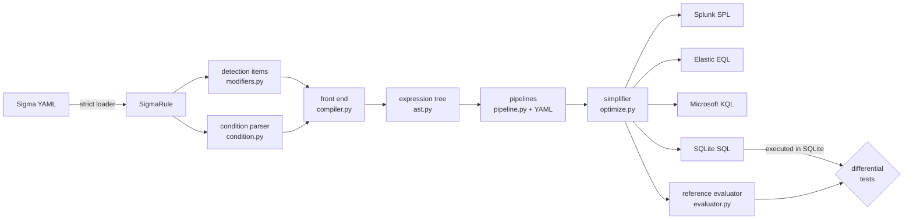

# sigmaforge

A Sigma detection-rule **compiler** written in Python 3.12. It parses Sigma YAML into a typed,
backend-neutral expression tree, runs YAML field-mapping pipelines over it, and renders it for
four targets: **Splunk SPL**, **Elastic EQL**, **Microsoft KQL** (Sentinel / Defender XDR) and
**SQLite SQL**. A **reference evaluator** defines what a rule means; the SQL backend is checked
against it by **property-based differential tests** that execute the generated SQL in SQLite.

```console
$ sigmaforge compile -t kql examples/rules/
// Office Application Spawning A Shell (examples/rules/proc_office_child_shell.yml)
DeviceProcessEvents
| where (InitiatingProcessFolderPath endswith "\\WINWORD.EXE" or InitiatingProcessFolderPath endswith "\\EXCEL.EXE") and (FolderPath endswith "\\cmd.exe" or FolderPath endswith "\\powershell.exe") and not(ProcessCommandLine contains "ApprovedAddin")
...
```

It is a compiler, not a linter: it does not grade rule quality or style. It answers "what query
does this rule become on target X, and if it cannot become one, exactly why not?"

## Who it is for

* Detection engineers who keep rules in Sigma and need SIEM queries they can read and trust.
* People evaluating Sigma tooling who want to see where each query language *cannot* express
  a rule (keyword search in EQL/KQL, look-around regexes in RE2, word boundaries in Lucene...).
* Anyone interested in how to test a compiler whose targets you cannot run locally: the SQL
  backend is executed, the other three are pinned by golden files and construct-level tests,
  and the Splunk `| where` dialect is also checked by a three-valued (NULL-aware) interpreter
  of its output.

## What it supports

| area | supported |
|---|---|
| detection forms | field mappings (AND), lists of mappings (OR), value lists (OR / AND with `all`), keyword lists, `null` values |
| conditions | `and`, `or`, `not`, parentheses, `1 of x*`, `all of x*`, `1 of them`, `all of them` (excluding `_`-prefixed identifiers), lists of conditions (OR-ed), precedence `not > and > or` |
| modifiers | `contains startswith endswith all re` (+ `i m s`) `cidr cased exists gt gte lt lte base64 base64offset wide utf16le utf16be utf16 windash` |
| rejected with a reason | aggregations (`\| count() ...`), correlation rules, multi-document files, `expand`, `fieldref` |
| pipelines | `field_name_mapping` (1:1, 1:many, fallback prefix), `field_name_prefix`, `add_condition`, `set_state`, `change_logsource`, `field_allowlist`, `rule_failure`; gated by logsource conditions |
| built-in pipelines | `ecs-windows` (Elastic), `splunk-windows` (Splunk Windows TA / Sysmon), `sentinel-windows` (Defender XDR tables) |
| CLI | `compile`, `report`, `eval`, `sql-run`, `ast`, `pipelines` |

## Architecture



Every backend consumes the same tree. Matchers are typed leaves (`StrMatch` with parsed
wildcards, `RegexMatch`, `CidrMatch`, `NumMatch`, `CmpMatch`, `NullMatch`, `ExistsMatch`), so a
backend never re-parses Sigma syntax. `docs/ARCHITECTURE.md` covers the algorithms (precedence
parsing, NULL-safe negation, the Splunk search/where split, PCRE-to-Lucene translation) and
their complexity.

## Quickstart

Requires Python 3.12 and [uv](https://docs.astral.sh/uv/).

```console
$ git clone https://github.com/SlateGitOrg/sigmaforge && cd sigmaforge
$ make check                          # format, lint, mypy --strict, 684 tests, coverage gate
$ uv run sigmaforge compile -t kql examples/rules/
$ uv run sigmaforge compile -t splunk -f json -o out.json examples/rules/
$ uv run sigmaforge report third_party/sigmahq/rules -o report.md
$ uv run sigmaforge eval examples/rules/proc_encoded_powershell.yml examples/events/windows.jsonl
$ uv run sigmaforge sql-run examples/rules -e examples/events/windows.jsonl
$ uv run sigmaforge ast -p ecs-windows examples/rules/net_internal_c2_port.yml
```

Each backend applies its default pipeline (`splunk-windows`, `ecs-windows`,
`sentinel-windows`; none for SQL). Add your own with `-p my_pipeline.yml` (repeatable) or turn
the defaults off with `--no-default-pipelines`. `compile` exits 1 if any rule fails, unless
`--allow-failures`; failures always go to stderr with the reason.

As a library:

```python
from sigmaforge import compile_rule, get_backend, load_pipeline, parse_rule

rule = parse_rule(open("rule.yml").read())
compiled = compile_rule(rule, [load_pipeline("sentinel-windows")])
print(get_backend("kql").convert(compiled).text)
```

## Demo

`make demo` runs offline against the bundled example rules and synthetic events. Excerpt from a
real run (the `// title` comment lines are trimmed; run `make demo` for the full output):

```text
== 3. the same rule for all four backends
-- splunk
source="XmlWinEventLog:Microsoft-Windows-Sysmon/Operational" AND EventCode=1 AND (ParentImage="*\\WINWORD.EXE" OR ParentImage="*\\EXCEL.EXE") AND (Image="*\\cmd.exe" OR Image="*\\powershell.exe") AND NOT CommandLine="*ApprovedAddin*"
-- eql
process where (process.parent.executable like~ "*\\WINWORD.EXE" or process.parent.executable like~ "*\\EXCEL.EXE") and (process.executable like~ "*\\cmd.exe" or process.executable like~ "*\\powershell.exe") and not process.command_line like~ "*ApprovedAddin*"
-- kql
DeviceProcessEvents
| where (InitiatingProcessFolderPath endswith "\\WINWORD.EXE" or InitiatingProcessFolderPath endswith "\\EXCEL.EXE") and (FolderPath endswith "\\cmd.exe" or FolderPath endswith "\\powershell.exe") and not(ProcessCommandLine contains "ApprovedAddin")
-- sql
SELECT * FROM "events" WHERE ("ParentImage" LIKE '%\\WINWORD.EXE' ESCAPE '\' OR "ParentImage" LIKE '%\\EXCEL.EXE' ESCAPE '\') AND ("Image" LIKE '%\\cmd.exe' ESCAPE '\' OR "Image" LIKE '%\\powershell.exe' ESCAPE '\') AND NOT coalesce("CommandLine" LIKE '%ApprovedAddin%' ESCAPE '\', 0)

== 6. execute the SQL backend in SQLite and cross-check against the evaluator
kw_credential_dumper_strings.yml         sqlite=[14] evaluator=[14] agree
net_internal_c2_port.yml                 sqlite=[8] evaluator=[8] agree
proc_base64_whoami.yml                   sqlite=[13] evaluator=[13] agree
proc_certutil_download.yml               sqlite=[4] evaluator=[4] agree
proc_curl_post_data.yml                  sqlite=[15] evaluator=[15] agree
proc_encoded_powershell.yml              sqlite=[0, 1, 2] evaluator=[0, 1, 2] agree
proc_office_child_shell.yml              sqlite=[6] evaluator=[6] agree
reg_run_key_persistence.yml              sqlite=[11] evaluator=[11] agree
sec_failed_logons_by_type.yml            sqlite=[17] evaluator=[17] agree
0 disagreement(s), 0 failure(s)

== 7. compile coverage over the pinned SigmaHQ subset (summary)
splunk  200/200 compiled
eql     192/200 compiled
kql     136/200 compiled
sql     192/200 compiled
```

The example events are hand-built and benign (see `DATA.md`); `examples/events/expected.json`
holds the hand-labelled verdicts, which a test compares against the evaluator.

## Evaluation

All numbers below come from committed commands; rerun them to reproduce.

### Compile coverage on real rules — `make compile-report`

200 rules sampled deterministically from SigmaHQ release `r2026-07-01` (evenly spaced over the
sorted file list of 13 directories, see `scripts/fetch_sigmahq.py`), each backend with its
default pipeline. Full per-rule table: [`docs/sigmahq-compile-report.md`](docs/sigmahq-compile-report.md).

| backend | compiled | failure reasons |
|---|---|---|
| Splunk SPL | 200 / 200 (100.0%) | none |
| Elastic EQL | 192 / 200 (96.0%) | keyword search (8) |
| Microsoft KQL | 136 / 200 (68.0%) | no KQL table for logsource (49), unmapped field (15) |
| SQLite SQL | 192 / 200 (96.0%) | keyword search (8): no `--sql-keyword-columns` given |

"Compiled" means a query was produced; it does **not** mean the query was run against that
SIEM. KQL is the strictest by design: the `sentinel-windows` pipeline maps only logsources it
knows a Defender XDR / Sentinel table for, and fails rules that use a column the table lacks
rather than emitting a query that silently never matches.

### Differential testing — `make check`, `make fuzz`

* `test_sql_backend_agrees_with_evaluator`: random rules generated at the YAML level
  (modifiers, value lists, keyword lists, random conditions with quantifiers) and random events
  biased towards near-misses of the rule's own values; generated SQL runs in SQLite and must
  select exactly the events the evaluator matches.
* `test_every_subtree_agrees`: the same, but every *subtree* of the rule is compared on every
  event, so a wrong leaf cannot hide behind the rest of the rule.
* `test_simplifier_preserves_semantics`: unsimplified vs simplified tree.
* `test_sigmahq_rules_differential`: all 200 pinned SigmaHQ rules, 15 generated event sets each.

300 examples per property in `make check` (fixed seed); `make fuzz` runs 5,000.

### How strong are those tests? — `make mutants`

`scripts/mutation_check.py` seeds 13 plausible bugs into the SQL backend, SQLite runtime,
evaluator and simplifier, and reruns the random part of the differential properties (no
hand-written examples) under 5 seeds of 300 examples each:

| mutant (seeded bug) | killed: whole rule + subtrees | killed: whole rule only |
|---|---|---|
| `NOT (x)` without `coalesce` (NULL leaks through negation) | 5/5 | 5/5 |
| LIKE `%` / `_` not escaped | 5/5 | 3/5 |
| GLOB `* ? [` not escaped | 5/5 | 4/5 |
| `cased` ignored | 5/5 | 3/5 |
| integer equality compares text only | 4/5 | 4/5 |
| `gt`/`lt` without the `typeof` guard | 5/5 | 4/5 |
| bare `*` compiled to constant true | 5/5 | 5/5 |
| regex flags dropped | 4/5 | 3/5 |
| keyword search on first column only | 5/5 | 5/5 |
| CIDR helper ignores address family | 5/5 | 4/5 |
| evaluator folds non-ASCII case | 5/5 | 3/5 |
| evaluator accepts `"04688"` for 4688 | 3/5 | 2/5 |
| simplifier flattens mixed AND/OR | 5/5 | 5/5 |
| **killed under every seed** | **10/13** | **4/13** |

Per-subtree comparison is what makes the suite sharp: 62 of 65 mutant runs are killed with
it versus 50 of 65 without. The first version of the generators (independent random events)
killed only 4 of 13 mutants at one seed; the rule-aware near-miss generators were written in
response, and this table is measured after that change. The `make check` suite additionally
pins seven hand-written `@example` cases that kill all 13 mutants deterministically
(`uv run python scripts/mutation_check.py --pinned-examples`); they were written knowing the
mutants, so treat them as regression pins rather than an independent measure. Front-end
bugs (parser, modifiers) are invisible to a differential test by construction - both sides
share the tree - and are covered by unit and golden tests instead.

### Coverage — `make check`

`uv run --frozen pytest --cov` reports **98.09%** branch coverage of `src/sigmaforge`
(gate: 90%, `fail_under` in `pyproject.toml`), 684 tests.

### Throughput — `make bench`

Single-threaded, Python 3.12.13, arm64 (8 cpus), median of 5 runs:

| stage | volume | seconds | rate |
|---|---|---|---|
| YAML load + validate | 200 rules | 0.241 | 829 rules/s |
| compile -> splunk | 200 rules | 0.042 | 4,712 rules/s |
| compile -> eql | 200 rules | 0.037 | 5,357 rules/s |
| compile -> kql | 200 rules | 0.035 | 5,652 rules/s |
| compile -> sql | 200 rules | 0.028 | 7,051 rules/s |
| reference evaluator | 9 rules x 20,000 events | 0.660 | 272,563 rule-event checks/s |
| SQLite queries (after a 0.083 s load) | 9 rules x 20,000 events | 0.062 | 2,896,009 rule-event checks/s |

The evaluator is a correctness oracle, not a production matcher; it is ~10x slower than the
SQLite engine running the compiled query.

## Design decisions

The full list with costs is in [`DECISIONS.md`](DECISIONS.md). The ones that shape the output:

* **One typed tree for all targets.** Wildcards are parsed once into `SigmaString` parts;
  backends pick native operators from the string's shape (`contains`, `startswith`, `=~`, ...)
  and fall back to anchored regexes only when they must.
* **Semantics are code.** The evaluator's docstring is the spec: ASCII-only case folding,
  integers match their decimal text, `gt`/`lt` never compare numeric-looking strings, keywords
  are substring matches over every value. The SQL backend is engineered to agree exactly.
* **Fail loudly, with a category.** Unsupported constructs raise `UnsupportedFeatureError` with
  a stable `feature` label, which is what the compile report aggregates.
* **Strict YAML.** `0x1410`, `010`, `yes` and dates stay strings; duplicate keys are errors.
* **Splunk search/where split.** Plain tests stay as indexed search terms; only conjuncts that
  need regexes go to a `| where` clause, and SPL's "OR binds tighter than AND" is respected.

## Limitations

* **Only the SQL backend is executed.** SPL, EQL and KQL output is checked by exact-output unit
  tests and 36 golden files, not by running Splunk, Elasticsearch or Kusto. Their operators were
  chosen from vendor documentation; small dialect mismatches are possible.
* **Field mappings are partial.** The built-in pipelines cover common Sysmon/Windows fields and
  a few Defender tables. EQL/Splunk pass unmapped fields through (`winlog.event_data.*` for
  Windows under ECS), which compiles but may not match a given index.
* **Known semantic gaps per target** (documented in the code): KQL `isempty` treats `""` like a
  missing field; EQL `.` in Lucene regexes matches newlines; Splunk eval regexes are PCRE;
  `NumMatch` against ECS `event.code` (a keyword field) may need a string comparison.
* **Not implemented:** aggregations / correlation rules, `expand` placeholders, `fieldref`,
  multi-document rule collections. They are rejected with a reason, never silently dropped.
* **Evaluator scope:** lists in events match element-wise in the evaluator but are stored as
  JSON text in SQLite, so the two can disagree on list-valued fields (generators avoid lists).
  Integers beyond 64 bits and floats are outside the differential guarantee.
* **Regex validation** uses Python `re` for the evaluator/SQL path and a structural RE2/Lucene
  check for KQL/EQL; a pattern can pass the check and still be rejected by a real engine.
* The SigmaHQ subset is 200 of the 3,142 rule files under `rules/` at the pinned commit and
  leans on Windows process creation (70 of 200); the numbers above are for that subset only.

## Roadmap

* Correlation rules (event_count, value_count, temporal) for SPL and KQL.
* `fieldref` and `expand` with placeholder pipelines.
* Optional execution of KQL output against a local Kusto emulator in a Docker-only
  integration target.
* More pipelines (Sysmon for Linux, CloudTrail for ECS).

## Repository map

```
src/sigmaforge/        compiler package (see docs/ARCHITECTURE.md for the module map)
src/sigmaforge/pipelines/  built-in YAML pipelines
examples/rules/        nine example rules written for this project
examples/events/       synthetic demo events + hand-labelled expected verdicts
third_party/sigmahq/   pinned SigmaHQ subset (DRL 1.1) + checksum manifest
tests/                 unit, golden, property, differential and integration tests
scripts/               fetch_sigmahq, mutation_check, bench, make_example_events
docs/                  ARCHITECTURE, THREAT_MODEL, generated compile report
```

## License

Code: MIT, see [LICENSE](LICENSE). The rules under `third_party/sigmahq/` are by the SigmaHQ project
and contributors under the Detection Rule License 1.1 (`third_party/sigmahq/DRL-1.1.md`); their
author attributions are kept intact.
